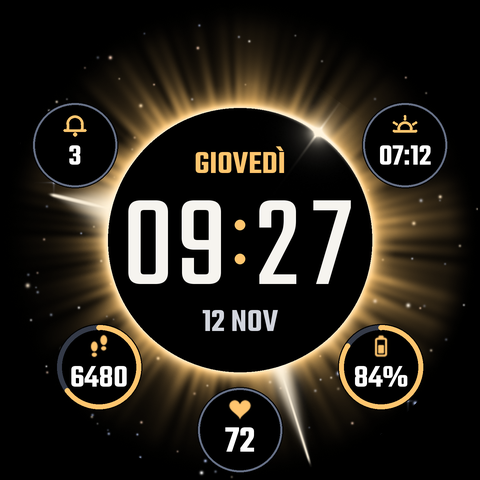

# ECLISSE

Quadrante nativo Wear OS (Watch Face Format 2) per Galaxy Watch, 480 x 480.
Pacchetto `com.local.watchface.eclisse`, versione 1.1. Progetto indipendente da
`WatchFace` (APEX): pacchetto diverso, si installa accanto senza sostituirlo.



## L'idea

Un'eclissi totale di Sole. Il disco nero della Luna contiene l'ora; tutto ciò che
si muove è luce.

- **La corona è l'orologio.** Il raggio corto e largo segna le ore, la lama lunga
  e sottile i minuti: sono lancette fatte di luce che escono da dietro la Luna.
- **L'anello di diamante segna i secondi.** La perla luminosa scorre sul bordo
  lunare con movimento continuo a 15 fps, non a scatti.
- **Profondità reale.** Due strati di stelle scorrono a velocità diverse quando
  si inclina il polso, e la corona si sposta in senso opposto, come una luce
  dietro un corpo opaco (giroscopio/accelerometro, nessun dato simulato).
- **Cinque lune satelliti** in transito davanti alla corona: passi (anello =
  obiettivo giornaliero), battito, batteria (anello = carica) e due complicazioni
  libere, predefinite su notifiche non lette e alba/tramonto. Ogni luna è un
  pulsante di 86 px con bordo, icona piena da 24 px e valore bianco da 32-38 px.
- Ore in Teko Regular da 134 px su nero OLED puro, in colonne fisse; giorno e
  data da 33 px nel disco.
- La corona è volutamente corta e calma: la luce non deve competere con i dati.
- Sei corone: Oro, Plasma, Aurora, Zaffiro, Brace, Luna.
- Always-on: restano l'ora, la data attenuata e un filo di luce attorno al disco.

Tocchi: luna dei passi → Samsung Health; luna del battito → frequenza cardiaca;
luna della batteria → stato batteria. La zona a ore 12 è lasciata libera per
l'indicatore di sistema.

## File

- `build/ECLISSE.apk`: APK firmato con la chiave debug locale.
- `res/raw/watchface.xml`: quadrante, generato da `tools/generate.py`.
- `res/drawable/*.png`: corona, bordo, raggi, perla e stelle, generati da
  `tools/make_assets.py` (procedurali, bianchi con alfa: il tema li colora).
- `design/preview-*.png`: anteprime di ogni tema e dell'always-on.
- `tools/layout.py`: geometria condivisa da asset, XML e anteprima.

## Ricostruzione

Prerequisiti: Python con `numpy`, `Pillow`, `fonttools`, `lxml`, `xmlschema`;
Android SDK in `C:\AndroidSdk` (build-tools 36.0.0, piattaforma 35); Java nel PATH.

```powershell
.\tools\build.ps1
C:\AndroidSdk\platform-tools\adb.exe install -r .\build\ECLISSE.apk
```

`-SkipAssets` salta la rigenerazione di font e bitmap. Dopo l'installazione il
quadrante si sceglie dall'elenco dei quadranti dell'orologio.

## Stato della verifica

- Verificato: schema XSD ufficiale WFF 2, riferimenti a stringhe, font, immagini
  e palette; compilazione, allineamento, firma e verifica della firma dell'APK.
- Verificato sul Galaxy Watch SM-L310 (versione 1.1, tema Oro): installazione,
  layout attivo, colorazione di corona e raggi, font incorporati, testo
  maiuscolo, dati reali di passi, battito e batteria, complicazioni predefinite.
  `design/device-v2.png` è un'acquisizione reale; `design/device-v1.png` è la
  prima versione, scartata perché poco leggibile.
- Le immagini `design/preview-*.png` sono anteprime simulate: lo stesso
  generatore che scrive l'XML compone gli stessi livelli con valori d'esempio.
  Sul dispositivo i testi cadono entro 1 px dall'anteprima.
- Non verificati: tocchi sulle lune (le destinazioni sono le stesse già provate
  in APEX), parallasse, layout always-on, gli altri cinque temi, passi oltre
  9999 (carattere ridotto), consumo di batteria.
- Nota: `letterSpacing` sul dispositivo disegna giunture dentro i glifi di Teko
  con contorni sovrapposti (G, O); per questo non è usato. Su "G" e "O" di
  giorno e data resta una traccia appena visibile a forte ingrandimento.
- All'installazione il log mostra due errori `DWF:ResourceManager ... Path is
  empty or null`; la causa non è stata accertata e il quadrante si carica.

## Font e riferimenti

Teko, The Teko Project Authors, SIL Open Font License 1.1 (`licenses/Teko-OFL.txt`).
Pesi Regular e SemiBold istanziati da `design/teko_variable.ttf`.

Schema WFF 2: https://github.com/google/watchface/tree/main/third_party/wff/specification/documents/2
