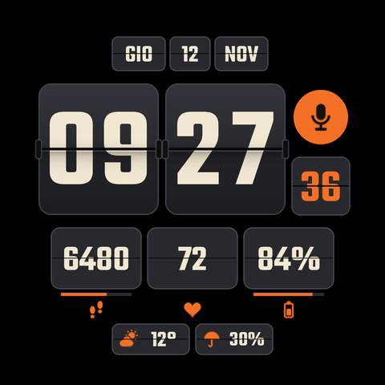

# PALETTE

Quadrante nativo Wear OS (Watch Face Format 2) per Galaxy Watch, 480 x 480:
un orologio a palette vintage. Pacchetto `com.local.watchface.palette`,
versione 1.1. Progetto indipendente da `WatchFace` (APEX) e `WatchFaceEclisse`.



## Cosa mostra

- **Ore e minuti**: due grandi palette con cerniera, cifre avorio da 142 px.
- **Secondi**: una palettina dedicata, in colore d'accento.
- **Data**: tre palettine in alto (giorno, numero, mese).
- **Registratore**: pulsante tondo a destra dell'ora. Dalla versione 1.1 apre
  REC (`C:\WatchProjects\WatchRec`), che inizia a registrare appena si apre.
  Richiede che REC sia installato; senza, il tocco non fa nulla.
- **Passi, battito, batteria**: una paletta ciascuno, senza scritte. L'icona
  sotto dice cos'è; passi e batteria hanno una barra di avanzamento. Un tocco
  apre Samsung Health, la frequenza cardiaca o lo stato della batteria.
- **Meteo**: due palettine in basso con condizione e temperatura attuali e
  probabilità di pioggia. Senza previsioni disponibili mostrano `--`.
- **Scatto animato**: una foglia cade sulla paletta a ogni cambio di secondo,
  minuto e ora.
- Cinque colori d'accento: Arancio, Ottone, Rosso, Verde, Azzurro.
- Always-on: solo il contorno delle due palette grandi, con ora e data attenuate.

## File

- `build/PALETTE.apk`: APK firmato con la chiave debug locale.
- `res/raw/watchface.xml`: quadrante, generato da `tools/generate.py`.
- `res/drawable/*.png`: palette, cerniere, fotogrammi dello scatto e icone,
  generati da `tools/make_assets.py`.
- `tools/layout.py`: geometria condivisa da asset, XML e anteprima.
- `design/preview-*.png`: anteprime simulate; `design/weather-glyphs.png`:
  le nove icone meteo e l'ombrello.

## Ricostruzione e installazione

Prerequisiti: Python con `numpy`, `Pillow`, `fonttools`, `lxml`, `xmlschema`;
Android SDK in `C:\AndroidSdk` (build-tools 36.0.0, piattaforma 35); Java nel PATH.

```powershell
.\tools\build.ps1
C:\AndroidSdk\platform-tools\adb.exe install -r .\build\PALETTE.apk
```

## Stato della verifica

- Verificato: schema XSD ufficiale WFF 2, riferimenti a stringhe, font e
  immagini; compilazione, firma e verifica della firma dell'APK.
- Verificato sul Galaxy Watch SM-L310 (colore Arancio): installazione,
  attivazione, layout attivo, font, dati reali di ora, data, secondi, passi,
  battito e batteria, meteo reale (icona, temperatura, probabilità di pioggia).
  `design/device-v1.png` è un'acquisizione reale dello schermo.
- Le immagini `design/preview-*.png` sono anteprime simulate con valori
  d'esempio, prodotte dallo stesso generatore che scrive l'XML.
- Scatto animato: confermato a vista dall'utente sull'orologio (le palette
  scattano a ogni secondo e minuto). Le schermate automatiche non ne hanno
  colto alcun fotogramma, quindi non c'è un'acquisizione che lo documenti.
- Non verificati: i tocchi compreso il registratore, le altre icone
  meteo e il caso senza previsioni, l'always-on, gli altri quattro colori, i
  passi oltre 9999 (carattere ridotto), il consumo. Il log del runtime non è
  stato letto: il debug wireless dell'orologio è caduto durante la verifica.
- Il meteo richiede che l'orologio riceva la posizione dal telefono o dalla rete.
- I codici delle condizioni meteo seguono la documentazione ufficiale:
  https://developer.android.com/reference/wear-os/wff/common/attributes/source-type

## Font

Teko, The Teko Project Authors, SIL Open Font License 1.1 (`licenses/Teko-OFL.txt`).
Peso SemiBold istanziato da `design/teko_variable.ttf`.
